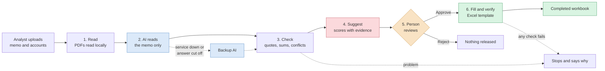
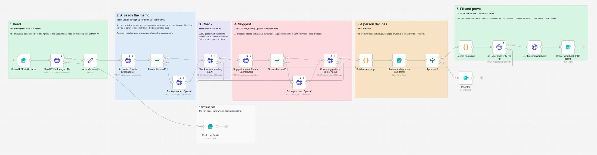
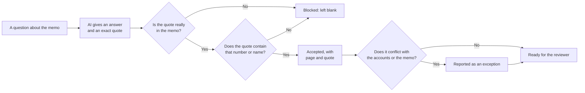

# Investment Screening Automation

Reads an investment memo and a set of audited accounts, checks them, and fills in an investor's Excel screening template. A person reviews the findings and approves before anything is released.

> **In one line:** n8n runs the process, AI only reads, plain rules check, and a person decides.

## What it does

A first screening means reading two documents, copying dozens of figures into a spreadsheet, and noticing what doesn't add up. This workflow does the copying and the checking, and leaves the judgement to the analyst.

| You give it | You get back |
|---|---|
| An investment memo (PDF) | The **completed Excel screening template**, with its formulas, colours and dropdowns intact |
| Audited accounts (PDF) | An **Exceptions** tab: what doesn't add up, why it matters, and a question for the company |
| | An **Extraction Log** tab: where every value came from, with page and quote |
| | A **Checks** tab: what was tested, and who approved it |

## How it works



| Step | In plain words | Tool |
|---|---|---|
| **1. Read** | Both PDFs are read on this computer. The figures in the accounts are taken directly, without AI. | n8n form, PDF reader |
| **2. AI reads** | AI answers a fixed list of questions about the memo. Each answer must include an exact quote. If the service is down or does not finish, a backup from another company takes over. | Claude through OpenRouter; OpenAI as backup |
| **3. Check** | Every quote must really be in the memo. Numbers and names must match their quotes. The accounts must add up. | Plain rules |
| **4. Suggest** | AI proposes scores using the investor's own guide. Any score without verified evidence is dropped. | Claude (OpenAI as backup), then plain rules |
| **5. A person decides** | The analyst sees the serious issues, can change any answer, then approves or rejects. | n8n form |
| **6. Fill and verify** | The template is filled, recalculated and read back. It is released only if every check passes. | Excel template, LibreOffice |



## Why you can trust the output

Borrowing an idea every finance team knows: **maker and checker**. The AI makes a suggestion. Rules and a person check it.



| Safeguard | What it prevents |
|---|---|
| Every answer needs a quote that is found in the document | Invented answers |
| The number or name must be inside its quote | A real quote attached to a wrong answer |
| A backup AI from another company takes over | An outage or an answer cut off halfway |
| Figures from the accounts are read by rules, not AI | Misread numbers |
| Sums, balances and conflicts are tested by plain rules | Errors in the company's own documents |
| Mistakes in the documents are reported, **never corrected or forced to balance** | Hidden problems |
| Missing information stays blank | False confidence |
| Instructions hidden in a memo are reported and can't change a calculated score | Manipulation by a borrower |
| The finished file is compared with the original template | A damaged template |

## Data protection

- The **accounts file is never sent to any AI**, and its figures are read by rules. The scoring step does receive the list of issues found, which quotes some figures from the accounts.
- In this demonstration, the memo text goes to Claude through OpenRouter, restricted to providers that do not keep it. The OpenAI backup is called only if that fails. It is asked not to store the text, though OpenAI may keep API data for up to 30 days to check for abuse.
- **In production, the AI step is designed to move to a model hosted on the firm's own server**, with no outside access. Only that step changes.
- Whatever model is used must first pass the same accuracy test.
- No company documents, API keys or results are stored in this repository.

## What's in this repository

```text
n8n/        the workflow and how to start it
service/    a small local helper: reads PDFs, runs the rules, fills the template
tests/      automated tests and the accuracy measurement
docs/       picture of the workflow
```

**Deliberately not included:** the investor's template, the sample documents, the rules workbook, the answer key and all results. They belong to the investor, or are derived from its material.

### Why there is any code at all
n8n has no built-in step that fills an existing Excel file while keeping its formulas, colours and dropdowns. The helper covers that gap and runs the checks. The questions, accepted line names, settings, wording and AI instructions are in an **Excel rules workbook** that staff can edit without programming.

## Setting it up

You need Docker, an [OpenRouter](https://openrouter.ai) key, the screening template and the rules workbook (`config/field_map.xlsx`).

```bash
cd n8n
cp .env.example .env      # then add your own values
docker compose up -d --build
```

1. Open http://localhost:5678 and create a local account.
2. Add an OpenRouter credential, and an OpenAI credential for the backup.
3. Import `n8n/ahl_screening_workflow.json` and choose those credentials in the four AI steps.
4. Publish the workflow and open its form.

It is reachable only from your own computer.

## Testing

```bash
pip install -r service/requirements.txt pytest httpx
pytest tests/test_service.py
```

The 43 tests cover correct runs, invented quotes, wrong numbers, AI failures, changed and missing figures, hidden instructions, swapped files and a damaged template. They need the private sample documents and are skipped without them.

## Known limits

- Reads text PDFs in USD thousands. Scanned documents are refused with a clear message.
- Account lines it doesn't recognise are reported, not guessed.
- Tested on one company so far.
- AI gives stable facts but not always the same scores, which is why a person approves them.
- The AI steps usually take one to two minutes in total.
- One AI reads the memo at a time, to keep cost and waiting low. The rules workbook and helper can also compare two readers, if a firm wants a second opinion on larger deals.

## Next steps

- Move the AI step to a model on the firm's own server.
- Connect to Microsoft 365: documents arrive from SharePoint, approvals go through Teams.
- Test on more companies, then extend to portfolio reports and covenant checks.
